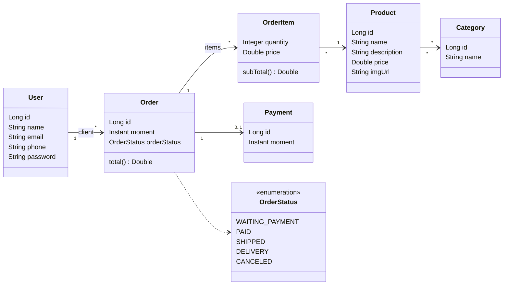

# springCrud

API REST de um sistema de pedidos simples (usuários, produtos, categorias, pedidos e pagamentos), construída com **Spring Boot**, **Spring Data JPA** e **H2**. O foco do projeto é a modelagem de domínio com JPA e a organização em camadas: cada responsabilidade fica em uma camada própria, desde o controller REST até o repositório.


---

## Funcionalidades

- **CRUD completo de usuários**: listar, buscar por ID, criar, atualizar e remover.
- **Consulta de produtos, categorias e pedidos**: listagem e busca por ID.
- **Total do pedido calculado**: o JSON do pedido traz o `total`, somado a partir dos subtotais dos itens.
- **Tratamento global de exceções** com `@ControllerAdvice`, que devolve um corpo de erro padronizado.
- **Carga de dados automática** no perfil `test`, para a API já subir com dados para testar.
- **Console do H2** habilitado para inspecionar o banco pelo navegador.

## Stack

| Camada         | Tecnologia                                             |
| -------------- | ------------------------------------------------------ |
| Linguagem      | Java 25                                                |
| Framework      | Spring Boot 4.1 (Web MVC)                              |
| Persistência  | Spring Data JPA / Hibernate                            |
| Banco de dados | H2 em memória (Postgres já incluído no `pom.xml`) |
| Build          | Maven (wrapper incluso)                                |

## Modelo de domínio



Alguns detalhes da modelagem:

- **`OrderItem` usa chave composta** (`@EmbeddedId` com `OrderItemPk`), formada por pedido + produto. O item guarda o **preço do momento da compra**, então uma mudança posterior no preço do produto não altera pedidos antigos.
- **`Payment` compartilha o ID do pedido** (`@OneToOne` + `@MapsId`).
- **`OrderStatus` é gravado como inteiro** no banco. O código fica explícito no enum, então reordenar os valores não corrompe os dados.
- **`Product` ↔ `Category`** é um relacionamento muitos-para-muitos, com a tabela de junção `tb_product_category`.
- **Referências circulares no JSON** são cortadas com `@JsonIgnore`. Por exemplo, o usuário não lista seus pedidos, mas o pedido mostra o cliente.

## Arquitetura

```
src/main/java/com/project/springCrud
├── config/          # TestConfig: popula o banco no perfil "test"
├── entities/        # Entidades JPA
│   ├── enums/       # OrderStatus
│   └── pk/          # OrderItemPk (chave composta)
├── repositories/    # Interfaces JpaRepository
├── services/        # Regras de negócio
│   └── exceptions/  # ResourceNotFoundException, DatabaseException
└── resources/       # Controllers REST
    └── exceptions/  # ResourceExceptionHandler + StandardError
```

Uma requisição percorre as camadas nesta ordem:

```
HTTP → Resource (controller) → Service → Repository → Banco
                    ↑                ↓
                    └── ResourceExceptionHandler ← exceções de serviço
```

## Endpoints

### Usuários: `/users`

| Método    | Rota            | Descrição                      | Sucesso                               |
| ---------- | --------------- | -------------------------------- | ------------------------------------- |
| `GET`    | `/users`      | Lista todos                      | `200 OK`                            |
| `GET`    | `/users/{id}` | Busca por ID                     | `200 OK`                            |
| `POST`   | `/users`      | Cria um usuário                 | `201 Created` + header `Location` |
| `PUT`    | `/users/{id}` | Atualiza nome, e-mail e telefone | `200 OK`                            |
| `DELETE` | `/users/{id}` | Remove                           | `204 No Content`                    |

### Produtos, categorias e pedidos (somente leitura)

| Método | Rota                 | Descrição                                         |
| ------- | -------------------- | --------------------------------------------------- |
| `GET` | `/products`        | Lista produtos com suas categorias                  |
| `GET` | `/products/{id}`   | Busca produto por ID                                |
| `GET` | `/categories`      | Lista categorias                                    |
| `GET` | `/categories/{id}` | Busca categoria por ID                              |
| `GET` | `/orders`          | Lista pedidos com itens, cliente, pagamento e total |
| `GET` | `/orders/{id}`     | Busca pedido por ID                                 |

### Exemplos

Criar um usuário:

```bash
curl -X POST http://localhost:8080/users \
  -H "Content-Type: application/json" \
  -d '{"name":"Maria Souza","email":"maria@email.com","phone":"988887777","password":"123456"}'
```

Resposta de `GET /orders/1`:

```json
{
  "id": 1,
  "moment": "2019-06-20T19:53:07Z",
  "orderStatus": "PAID",
  "client": { "id": 1, "name": "José Ribeiro", "email": "jose@gmail.com", "phone": "9999222", "password": "123456" },
  "items": [
    { "product": { "id": 1, "name": "The Lord of the Rings", "...": "..." }, "quantity": 2, "price": 90.5, "subTotal": 181.0 },
    { "product": { "id": 3, "name": "Macbook Pro", "...": "..." }, "quantity": 1, "price": 1250.0, "subTotal": 1250.0 }
  ],
  "payment": { "id": 1, "moment": "2019-06-20T21:53:07Z" },
  "total": 1431.0
}
```

## Tratamento de erros

As exceções da camada de serviço são convertidas em respostas HTTP por um `@ControllerAdvice`. O corpo do erro segue sempre o mesmo formato:

```json
{
  "timestamp": "2026-11-06T14:30:00Z",
  "status": 404,
  "error": "Resource not found",
  "message": "Resource not found. Id: 99",
  "path": "/users/99"
}
```

| Exceção                     | Quando ocorre                                                 | Status  |
| ----------------------------- | ------------------------------------------------------------- | ------- |
| `ResourceNotFoundException` | ID inexistente em busca ou atualização                      | `404` |
| `DatabaseException`         | Violação de integridade (ex.: remover usuário com pedidos) | `400` |

## Como executar

**Pré-requisito:** JDK 25. O Maven não precisa estar instalado, porque o projeto usa o wrapper.

```bash
git clone https://github.com/phietrogerbiel-hue/crudSpringbootJPA.git
cd crudSpringbootJPA

# Linux / macOS
./mvnw spring-boot:run

# Windows
mvnw.cmd spring-boot:run
```

A API sobe em `http://localhost:8080` com o perfil `test` ativo e o banco populado com usuários, produtos, categorias e pedidos de exemplo.

### Console do H2

Acesse `http://localhost:8080/h2-console` com:

| Campo    | Valor                  |
| -------- | ---------------------- |
| JDBC URL | `jdbc:h2:mem:testdb` |
| User     | `sa`                 |
| Password | *(vazio)*            |

> O banco é em memória: todos os dados são recriados a cada reinício.

## Limitações conhecidas

- **A senha do usuário aparece no JSON das respostas** e é gravada em texto puro. Não há Spring Security nem hash de senha.
- **Não há validação de entrada** (`@Valid`/Bean Validation): campos vazios ou e-mails inválidos são aceitos.
- **Produtos, categorias e pedidos são somente leitura** pela API.
